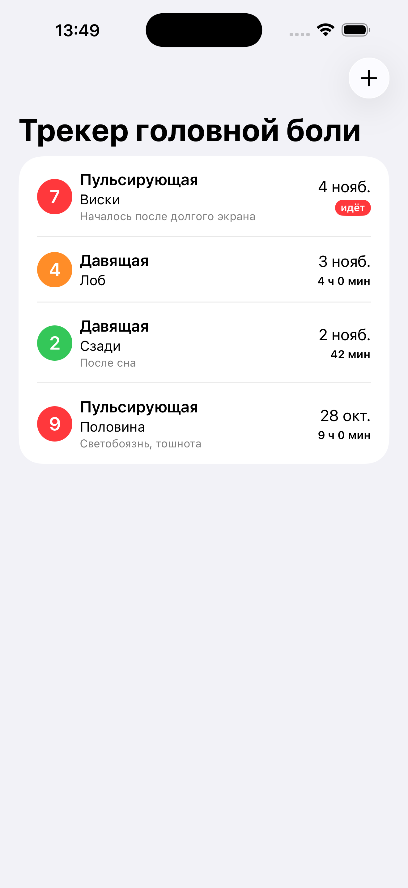

# HeadacheTracker

Дневник головной боли. Эпизоды записываются, чтобы увидеть, меняется ли
что-то со временем: чаще или реже, сильнее или слабее, помогает ли препарат.
Отдельная запись почти ничего не говорит — смысл появляется в ряде.

## Скриншоты

 

## Стек

- SwiftUI, iOS 17.0+
- Данные живут в памяти — персистентность следующим этапом
- Тесты: Swift Testing
- CI: GitHub Actions, `xcodebuild test` на pull request и push в `main`

## Дальше

- Сохранение между запусками
- Правка и удаление записей
- График частоты и интенсивности за месяц
- Препараты: что принял, через сколько помогло
